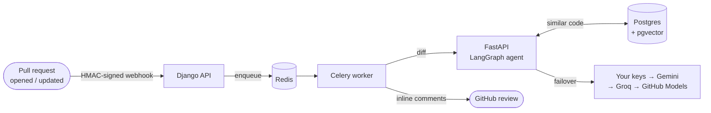

  

  
  
  
  

 

I build **Python backends** with Django, FastAPI, Postgres, Redis and Celery, and I've been building **tools that review and check AI-written code**.
I write tests before features, record design trade-offs, and give every README a *Known limitations* section.

 

## 🧠 DevMind: AI pull-request reviewer

  
  
  
  
  

Open a pull request and DevMind reads the diff, reviews it for **security, quality and test coverage** in parallel, scores the risk from 0 to 100, and posts the findings back as **inline review comments**.

<table>
<tr>
<td width="50%" valign="top">

**🕸️ 7-node LangGraph agent** 
Three analyzers run as parallel branches, then results are de-duplicated and sorted by severity. A low-confidence review loops back, up to 3 passes.

**🔁 LLM failover** 
Your own API keys first, then Gemini, Groq and GitHub Models. One Redis rate limit is shared by every worker.

</td>
<td width="50%" valign="top">

**🔐 Security** 
Webhook signatures are checked before parsing. OAuth tokens and API keys are encrypted at rest. User-supplied URLs can't reach private IPs (SSRF guard).

**📈 Built to operate** 
9 services in Docker Compose. Prometheus metrics, a provisioned Grafana dashboard, and CI that runs pytest against real Postgres and Redis.

</td>
</tr>
</table>

  

 

## 👟 SneakIn: full-stack sneaker store

  
  
  

A store with catalog filters, cart, wishlist, orders and an admin dashboard. Admins get an automated **daily sales report** from Celery Beat.

<table>
<tr>
<td align="center"> Home</td>
<td align="center"> Collection</td>
<td align="center"> Product</td>
</tr>
</table>

- 🔒 **No overselling.** Placing or cancelling an order locks the product rows, so two buyers can't take the last pair.
- 🪪 **JWT with rotation and blacklisting.** Every API view requires login unless it's explicitly public.
- 🧭 **Planning the move to services.** I wrote an [architecture analysis](https://github.com/muhammedsiinanmp/Sneak-in-ecommerce/tree/architecture/microservices-migration) using the strangler-fig pattern. It recommends 4 deployables and a worker, not one service per app, to avoid a distributed monolith.
- 🚀 **Shipped.** Nginx, Gunicorn, Postgres, Redis, Celery and Flower run in Docker Compose. GitHub Actions deploys to AWS EC2.

  

 

## 🏭 Currently building

> [!NOTE]
> **[OpenFactory](https://github.com/muhammedsiinanmp/openfactory)** is an early-stage, spec-driven control plane for AI coding agents. Requirements become a task DAG, and each task runs in its own git worktree. Tests decide what passes, and every commit traces back to a requirement. *Phase 1 is in progress.*

 

## 🧩 More work

| | Project | What it is |
|:-:|---|---|
| 🎓 | [**Edustream**](https://github.com/muhammedsiinanmp/Edustream) | Course enrollment with an approval workflow. Students request courses and a principal approves them. Django · PostgreSQL · 172 tests |
| 🤝 | [**oss-contributor-agent**](https://github.com/muhammedsiinanmp/oss-contributor-agent) | Agents find open-source issues and draft fixes. A human approves every plan, diff and push |
| 💼 | [**Zignature**](https://github.com/mohmdsaalim/zignature-semantics) | Team job-agency platform. I set up the Django scaffold, user model, Docker + Nginx stack and OpenAPI docs |
| 📐 | [**system-design-mastery**](https://github.com/muhammedsiinanmp/system-design-mastery) | 33 topics so far, each covering how a system works, where it breaks, and the trade-offs, with sources cited |
| 🧮 | [**Leetcode**](https://github.com/muhammedsiinanmp/Leetcode) | Python solutions by topic, each with its approach and complexity, plus a repo-wide test script |

 

## 🛠️ Toolbox

   
  

Also: Celery · LangGraph · pgvector · pytest · uv · Claude Code. &nbsp;Learning Go (not production-level yet).

 

  <picture>
    <source media="(prefers-color-scheme: dark)" srcset="https://streak-stats.demolab.com?user=muhammedsiinanmp&theme=tokyonight&hide_border=true&background=0D1117" />
    
  </picture>

